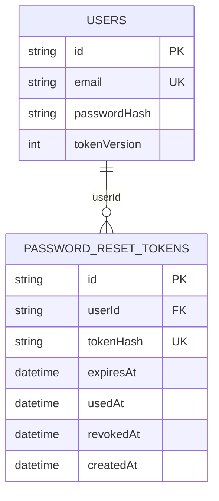

# FR-ACC-03 BE — Thiết kế quên và đặt lại mật khẩu

Trạng thái: đã triển khai trên nhánh BE ngày 28/10/2026 theo yêu cầu. Hướng dẫn chạy và những điểm khác với đề xuất ban đầu nằm trong `backend/src/password-reset/README.md`; outbox dùng thêm entity mail job riêng, User giữ nguyên bản FR-ACC-01.

## 1. Cơ sở và phạm vi

- Nhánh làm việc: `feature/FR-ACC-03-BE-forgot-reset-password`, tạo từ `develop` tại `fb8b921`.
- FE hiện có ba API trong `frontend/src/features/password-reset/api/password-reset.api.ts`; thiết kế giữ nguyên hợp đồng đó.
- Backend đăng nhập đang ở nhánh `feature/FR-ACC-01-BE-login-register`, commit khảo sát `7a46d3b`, chưa được tích hợp vào `develop` tại lúc thiết kế.
- Nhánh đăng nhập dùng TypeORM, SQLite (`better-sqlite3`), bảng `users`, bcrypt cost 10 và JWT có `tokenVersion`.
- Module account và 2FA hiện vẫn dùng Map trong RAM; thiết kế này không chuyển đổi dữ liệu hoặc sửa hai module đó.
- Mailer của nhánh đăng nhập hiện chỉ in email xác minh ra terminal; chưa có chức năng gửi email reset thật.

Mục tiêu: dùng chung tài khoản đăng nhập, phát hành liên kết reset hết hạn sau 30 phút, đổi mật khẩu một lần bằng token hợp lệ. Không tạo bảng tài khoản hoặc database thứ hai.

## 2. Cấu trúc dự kiến

```text
backend/src/password-reset/
├── password-reset.module.ts
├── password-reset.controller.ts
├── password-reset.service.ts
├── password-reset.service.spec.ts
├── password-reset.repository.ts
├── password-reset.repository.spec.ts
├── password-reset-mailer.port.ts
├── password-reset-rate-limiter.ts
├── password-reset-error.filter.ts
├── entities/
│   └── password-reset-token.entity.ts
└── dto/
    ├── forgot-password.dto.ts
    ├── validate-reset-token.dto.ts
    └── reset-password.dto.ts
```

- Controller: ba endpoint, DTO, status và headers đúng hợp đồng FE.
- Service: điều phối nghiệp vụ, tạo token, chính sách tài khoản và mật khẩu.
- Repository: thao tác token và cập nhật User trong cùng transaction.
- Mailer port: hợp đồng gửi email reset, adapter nối với dịch vụ email nhóm chốt; không tự xây hệ thống tài khoản/email thứ hai.
- Rate limiter: giới hạn theo IP và khóa email/token đã băm; không phụ thuộc tài khoản có tồn tại.
- Error filter: áp dụng riêng controller này để trả mã lỗi FE hiểu được, không đổi định dạng lỗi toàn hệ thống.

## 3. Entity mới: PasswordResetToken

Tên bảng: `password_reset_tokens`, cùng database với `users`.

| Trường | Kiểu dự kiến trên SQLite | Ý nghĩa |
|---|---|---|
| id | UUID lưu dạng text, primary key | ID bản ghi, không dùng làm token |
| userId | text, NOT NULL, có index | Tài khoản sở hữu token |
| tokenHash | varchar(64), UNIQUE, NOT NULL | SHA-256 của token ngẫu nhiên |
| expiresAt | datetime, NOT NULL | Thời điểm tạo + 30 phút, xử lý theo UTC |
| usedAt | datetime, NULL | Thời điểm token được tiêu thụ thành công |
| revokedAt | datetime, NULL | Thời điểm bị hủy bởi yêu cầu mới/reset thành công |
| createdAt | datetime, NOT NULL | Thời điểm tạo |

Chỉ mục phụ: `(userId, usedAt, revokedAt)` cho thao tác hủy token đang hoạt động; `expiresAt` phục vụ dọn dữ liệu hết hạn.

`userId` tham chiếu `users.id`. Nếu cần relation TypeORM để tạo foreign key, khai báo quan hệ một chiều tại entity token, không thêm thuộc tính ngược vào `User`. Chọn xóa token theo tài khoản khi tài khoản bị xóa. Tên cột phải được khai báo rõ để không sinh thêm cột userId thứ hai.



Entity `User` không đổi cấu trúc. Luồng reset chỉ cập nhật hai trường sẵn có: `passwordHash` và `tokenVersion`. Không cập nhật `isEmailVerified`, không tự bật 2FA hoặc đăng nhập sau reset.

Token gốc: 32 byte từ bộ sinh ngẫu nhiên mật mã, mã hóa base64url; chỉ gửi trong email và nhận lại từ FE. Database không lưu token gốc. Token reset tách biệt với verificationToken/verificationCode của xác minh email.

## 4. Hợp đồng API giữ tương thích FE

Base: `/api/v1/auth`. Các endpoint không yêu cầu JWT vì người dùng đang mất quyền truy cập, nhưng phải có giới hạn tần suất.

| API | Body | Thành công | Lỗi nghiệp vụ |
|---|---|---|---|
| POST /forgot-password | `{ "email": "..." }` | 202, thông báo tiếp nhận chung | 400 INVALID_EMAIL; 429 RATE_LIMITED |
| POST /reset-password/validate | `{ "token": "..." }` | 200 `{ "valid": true }` | 400 RESET_LINK_INVALID; 429 RATE_LIMITED |
| POST /reset-password | `{ "token": "...", "newPassword": "..." }` | 204, không body | 400 RESET_LINK_INVALID; 422 PASSWORD_POLICY_VIOLATION; 429 RATE_LIMITED |

Response lỗi ví dụ: `{ "error": { "code": "RESET_LINK_INVALID" } }`.

- Token sai, hết hạn, đã dùng, bị hủy hoặc tài khoản không còn đủ điều kiện đều cùng một mã RESET_LINK_INVALID.
- Validate chỉ kiểm tra, không tiêu thụ token; reset phải kiểm tra lại toàn bộ điều kiện.
- Email được trim và chuẩn hóa tương thích đăng nhập. Mật khẩu không trim hoặc tự chuẩn hóa.
- Thiếu token/sai kiểu token trả 400 RESET_LINK_INVALID. Sai kiểu hoặc không đạt chính sách mật khẩu trả 422 PASSWORD_POLICY_VIOLATION. Giới hạn độ dài input trước khi băm/truy vấn.
- Mọi response của module dùng Cache-Control: no-store; không trả token hay passwordHash ra API.
- 429 có Retry-After theo số giây. Dùng Retry-After trên 202 cho thời gian chờ gửi lại giống nhau ở mọi email. CORS cần expose header này cho FE khác origin.
- Lỗi hạ tầng chung trả 503 SERVICE_UNAVAILABLE. Không đưa lỗi provider/database hoặc nội dung nhạy cảm vào response.

## 5. Luồng yêu cầu khôi phục

1. Kiểm tra định dạng và chuẩn hóa email.
2. Áp dụng giới hạn IP/email cho cả email tồn tại và không tồn tại.
3. Tiếp nhận tác vụ gửi theo một quy trình thống nhất; trả 202 với thông báo chung. Không trả cờ accountExists hoặc thay đổi mã HTTP theo việc tìm được tài khoản.
4. Trong phần xử lý email, tìm User theo email. Đề xuất MVP: chỉ tài khoản email đã xác minh và có passwordHash mới đủ điều kiện; tài khoản chỉ dùng Google hoặc chưa xác minh vẫn nhận response 202 chung nhưng không được phát hành token reset. Đây là quy tắc đề xuất cần nhóm xác nhận.
5. Với tài khoản đủ điều kiện, transaction ghi token mới và hủy token cũ còn hoạt động của tài khoản. Serialize theo tài khoản để hai yêu cầu cùng lúc không tạo hai token đang hoạt động. Cần kiểm chứng cơ chế transaction/locking thực tế trên SQLite.
6. Tạo link từ FRONTEND_URL đã cấu hình: `/reset-password?token=...`; không lấy domain từ Host header của request.
7. Gửi link qua adapter email. Email ghi thời hạn 30 phút và hướng dẫn bỏ qua nếu không yêu cầu.

202 nghĩa là yêu cầu đã được tiếp nhận, không đảm bảo email đã đến hộp thư. Cách lưu hàng đợi, retry và xử lý provider lỗi là điểm tích hợp cần chốt trước triển khai: không giả lập console thành gửi email thật, không dùng tác vụ fire-and-forget mất dấu, không trả lỗi khác nhau theo tài khoản tồn tại. Nếu nhóm dùng outbox bền vững, token và yêu cầu gửi phải được lưu nguyên tử, token gốc trong payload phải được bảo vệ và xóa sau khi xử lý. Outbox/provider không được tự thêm vào phạm vi nếu nhóm đã có dịch vụ dùng chung.

## 6. Luồng đặt lại mật khẩu và chống dùng token hai lần

1. Kiểm tra input và rate limit.
2. Băm token nhận được, đọc bản ghi và tài khoản. Token chỉ hợp lệ khi chưa dùng, chưa bị hủy và `expiresAt > thời gian hiện tại`.
3. Kiểm tra chính sách mật khẩu chung, tạo bcrypt hash tương thích đăng nhập. Có thể thực hiện băm trước transaction để giảm thời gian giữ khóa; chưa cập nhật dữ liệu ở bước này.
4. Mở transaction. Kiểm tra lại tài khoản và token bằng thời gian mới; không tin kết quả từ bước validate hoặc lần đọc trước khi bcrypt chạy.
5. Claim token bằng UPDATE có điều kiện: đúng tokenHash/userId, usedAt và revokedAt đều NULL, expiresAt vẫn lớn hơn now. Chỉ tiếp tục khi affected rows = 1.
6. Cập nhật User cùng transaction: passwordHash mới; tăng tokenVersion nguyên tử một đơn vị để vô hiệu JWT cũ theo guard đăng nhập. Kiểm tra User vẫn tồn tại và đủ điều kiện.
7. Hủy các token reset khác đang hoạt động của User trong cùng transaction. Commit rồi trả 204.

Nếu bất kỳ bước cập nhật nào lỗi, rollback cả claim token lẫn cập nhật User. Hai request reset đồng thời dùng một token chỉ được một request trả 204; request còn lại phải bị từ chối sau khi đọc lại trạng thái. Lỗi khóa SQLite cần xử lý retry có giới hạn, không biến một lỗi database bất kỳ thành lỗi token hoặc trả thành công.

Sau thành công FE xóa token khỏi URL và dẫn về đăng nhập. Giới hạn này chỉ vô hiệu JWT dùng chung bảng users/tokenVersion; chưa giải quyết các phiên demo của module account/2FA dùng Map.

## 7. Quy tắc cần thống nhất với nhóm

| Nội dung | Đề xuất thiết kế / phụ thuộc |
|---|---|
| Nền đăng nhập | Triển khai tích hợp sau khi FR-ACC-01 BE được duyệt vào develop; không tự nhập cả nhánh chưa duyệt |
| Mật khẩu | Dùng bcrypt tương thích FR-ACC-01; tái sử dụng hàm băm public nếu phù hợp, không đổi thuật toán |
| Chính sách mật khẩu | Nhánh đăng nhập hiện yêu cầu 8–128 ký tự, hoa/thường/số/ký tự đặc biệt; cần chốt giới hạn byte tương thích bcrypt (72 byte) thay vì để hai luồng chấp nhận khác nhau |
| Tài khoản Google/chưa xác minh | MVP đề xuất không reset qua luồng này; nhóm xác nhận trước code |
| Email | Cần adapter/provider thật dùng chung; MailerService hiện chỉ có sendVerificationEmail và chưa export khỏi AuthModule |
| Rate limit | Đề xuất cấu hình: gửi lại cách 60 giây, tối đa 5 yêu cầu/email/giờ và 20 yêu cầu/IP/giờ; đây chưa phải AC đã chốt |
| Hạ tầng giới hạn tần suất | Map chỉ phù hợp bản chạy một tiến trình; nhiều instance cần kho dùng chung; không thêm Redis khi nhóm chưa thống nhất |
| Schema | Không sửa User entity. Token entity cần đăng ký với TypeORM; dùng migration theo cách nhóm chốt, không tự chạy synchronize trên dữ liệu thật |
| Log và token | Không ghi link/token/mật khẩu vào log ứng dụng, proxy hay APM; không dùng MailerService console hiện tại để in token reset |

## 8. Phạm vi sửa file để giảm conflict

| Nhóm file | Cách xử lý |
|---|---|
| backend/src/password-reset/** | Code mới thuộc FR-ACC-03 |
| backend/src/auth/entities/user.entity.ts | Không sửa |
| backend/src/auth/auth.controller.ts | Không sửa; controller mới dùng cùng prefix auth và ba route riêng |
| backend/src/auth/auth.service.ts | Ưu tiên không sửa; dùng chức năng băm public khi tích hợp |
| backend/src/auth/auth.module.ts | Chỉ phối hợp nếu cần export mailer/provider; không mặc định sửa |
| backend/src/app.module.ts | Điểm sửa chung: import PasswordResetModule và đăng ký token entity vào cấu hình TypeORM hiện có |
| backend/src/main.ts | Chỉ phối hợp nếu CORS hiện tại chưa expose Retry-After |
| backend/package.json, package-lock.json | Ưu tiên giữ nguyên, tận dụng thư viện của FR-ACC-01 |
| frontend/** | Không sửa trong PR backend này |

Không đổi cấu hình TypeORM toàn dự án để tránh vài dòng đăng ký entity. Không chuyển lại về User trong RAM để né phụ thuộc. Conflict còn có thể xảy ra tại file cấu hình chung; cập nhật develop và xử lý trước khi mở PR.

## 9. Kiểm thử và tiêu chí hoàn thành đề xuất

Các tiêu chí dưới đây là đề xuất thiết kế, không khẳng định là AC Jira đã được duyệt.

- Email đúng/sai định dạng; email tồn tại/không tồn tại có cùng status/body/Retry-After cho yêu cầu hợp lệ.
- Token sinh đủ ngẫu nhiên; database chỉ chứa hash. Không in token hoặc mật khẩu khi kiểm thử thất bại.
- Token còn hạn được validate; validate nhiều lần không tiêu thụ; đúng thời điểm 30 phút thì hết hạn.
- Token sai, đã dùng, bị hủy, tài khoản bị xóa hoặc không đủ điều kiện đều bị chặn.
- Reset thành công: bcrypt.compare với mật khẩu mới đúng; mật khẩu cũ sai; tokenVersion tăng; JWT cũ bị guard từ chối.
- Chính sách mật khẩu thống nhất đăng ký/đổi mật khẩu/reset; có ca Unicode và giới hạn byte bcrypt sau khi nhóm chốt.
- Hai request reset đồng thời: chỉ một lần thành công, không cập nhật mật khẩu hai lần; kiểm thử bằng SQLite thật dùng connection/cấu hình như ứng dụng, không chỉ mock repository.
- Lỗi khi ghi User: transaction rollback, không tiêu thụ token; lỗi SQLite busy không trả thành công giả.
- Yêu cầu gửi mới hủy token trước; hai yêu cầu gửi đồng thời vẫn chỉ có một token hoạt động theo quy tắc đã chọn.
- Rate limit trả 429 đúng Retry-After, FE đọc được qua CORS. Email provider lỗi/retry không làm lộ tài khoản hoặc bỏ mất trạng thái tác vụ.
- Kiểm tra lưu bền: restart backend, token đã dùng vẫn bị từ chối, User vẫn có mật khẩu đã đổi.
- Chạy lại kiểm thử auth/account/2FA, build và 12 bài FE với backend theo hợp đồng đã chốt.

## 10. Thứ tự triển khai sau khi thiết kế được xem

1. Nhóm chốt schema, chính sách tài khoản/mật khẩu, giới hạn tần suất và cơ chế email.
2. FR-ACC-01 BE được duyệt vào develop; cập nhật develop và nhánh FR-ACC-03 BE.
3. Triển khai token entity, migration/đăng ký schema và repository transaction.
4. Triển khai service, DTO, controller, rate limiter, ánh xạ lỗi và adapter email.
5. Kiểm thử transaction, hết hạn, dùng một lần, email và tương thích đăng nhập.
6. Tích hợp FE, kiểm thử luồng thực tế, mở PR vào develop và gán mentor review. Không tự merge.
